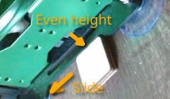
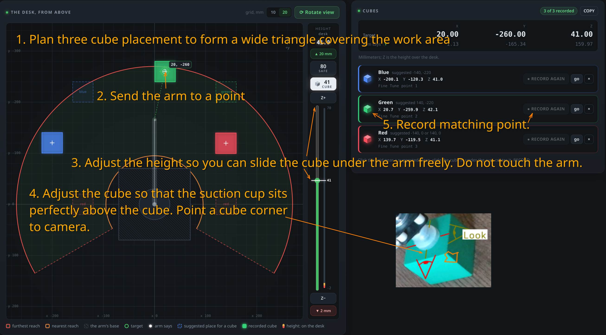
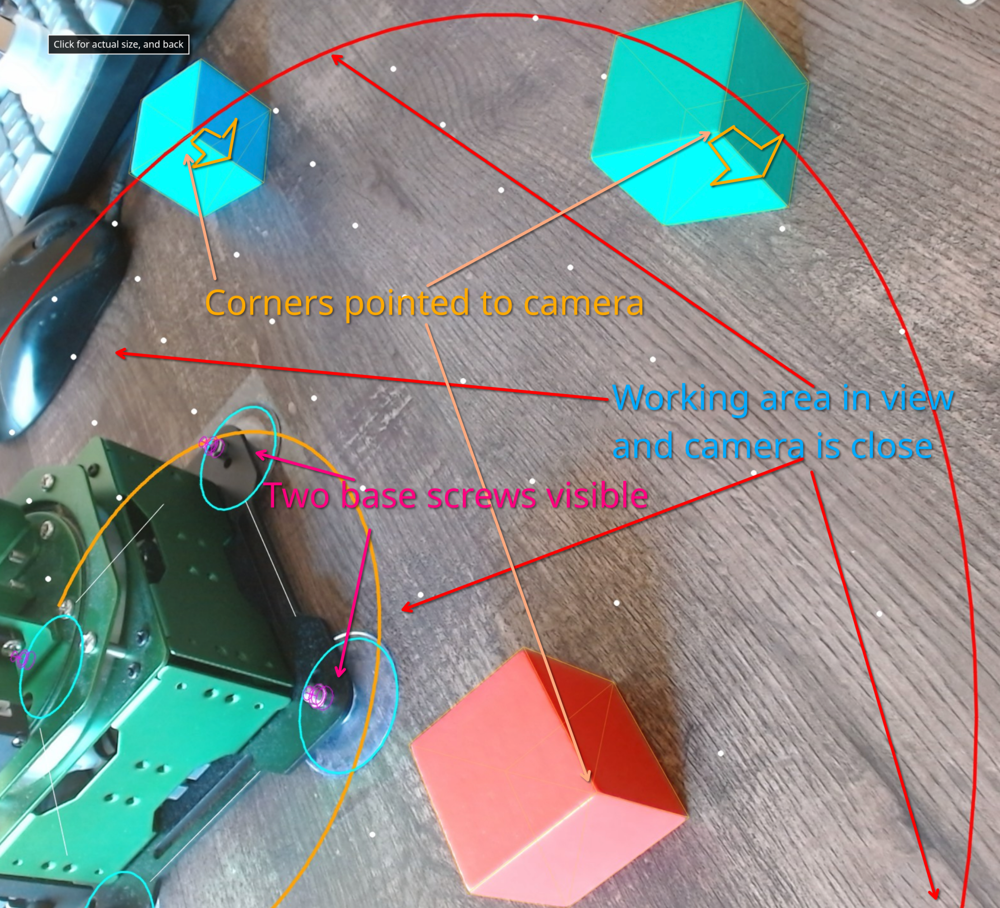
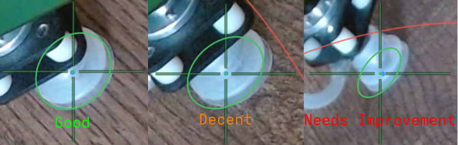

# About

This document is intended to explain and supplement in-app instructions for calibrating the camera and the arm.

In the webapp, clicking the *? HELP* icon will show the instructions for that page.

# Arm placement

- Ensure that the arm's suction cups are FIRMLY pressed against the desk surface.
- Use packing tape under the arm's suction cups to use as extra grip between the suction cups and the desk surface, if needed.
- Validate that the arm is level and not tilted to one side. See picture below for one of many ways that this can be checked
by using a stack of demo tiles.

If the arm is not perfectly leveled and snug against the desk,
the calibration will be inaccurate and the arm may not be able to pick up tiles.

# Launch The Webapp

Make sure to follow the main README.md instructions to set up the board and 
launch the webapp. The webapp will be used to calibrate the camera and the arm.

Take the time to play around with the **Desk** page and learn how the arm operates.

# Calibrate The Camera

The arm package will contain the three colored cubes (red, green, and blue).
The cubes will be used to calibrate the camera and the arm with the 
**Camera** webapp page.

Follow this screenshot of the calibration app to learn the steps for each cube.

USe the page's *? HELP* button to learn more.

This screenshot shows one of the possible camera placement scenarios and
key points to take while placing the cubes and the camera.

Use the **Camera** page to calibrate the camera and the arm and save the calibration.

# Calibration Fine-Tuning

The **Fine Tune** page allows you to validate the calibration against your arm
and add more points, in addition to the three colored cubes, to further 
improve the arm's accuracy.

Before you begin, it is advisable to take a look at the colored zones of the
**Tiles** page to understand the arm's reach and the areas where it can pick and place tiles.
The green area is where tiles are places and the blue area is where the arm the drops tiles off.

The best way to fine tune the calibration is to use **Fine Tune** page is to:
1. First, clear the desk.
1. Use the *Arm To Desk* function to click various points on the desk.
1. Based on the screenshot guide below, decide if the arm needs improvement in a given desk area: 

1. Either:
   - Send the arm to the area using the left desk grid...
   - Or place the red cube in the area and click *Find Red Cube*.
1. Align the cube below the arm like you did during the initial calibration.
1. Click *Record Point* to add the new point to the calibration. 
And accept the point if it visually matches the outline.
1. Click *Save Calibration* to save the new calibration.
1. Repeat the process until the arm "decently" matches te camera in the working area.
